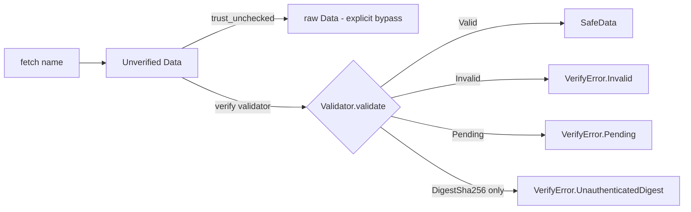

# The security model

NDN's central thesis is *secure the data, not the channel*: every Data packet
is signed, and a consumer must verify that signature against a trust anchor
before trusting the bytes. In most stacks that verification is a discipline —
the API hands you the bytes and trusts you to call the validator. ndn-rs makes
it a **type transition the compiler enforces**, so "did I actually verify this?"
is answered by the type of the value in your hand, not by reading the call site.
This is the design recorded in [ADR 0002](../adr/0002-type-enforced-verification.md);
this page is how it works in the code.

The security core is `ndn-security`; certificates layer on in `ndn-cert` and
identity lifecycle in `ndn-identity`.

## Two types, one invariant

The whole model rests on a pair of dual types in `ndn-security`.

`SafeData` (`crates/security/ndn-security/src/safe_data.rs`) is *"this Data was
verified."* Its fields are `pub(crate)`, so nothing outside `ndn-security` can
construct one with a struct literal. In a normal build the **only** way to
obtain a `SafeData` is to run a `Validator` and have the signature check
succeed — the crate mints it inside `Validator::validate`. A `SafeData` records
not just the payload but *how* it earned trust, in a `TrustPath`:

| `TrustPath` variant | Meaning |
|---|---|
| `CertChain(Vec<Name>)` | Validated via a certificate chain to a trust anchor. |
| `LocalFace { uid }` | Trusted because it arrived on a local face with known process credentials. |
| `DigestSha256` | Only a self-contained `SHA-256(signed_region) == sig_value` integrity check — no key, no anchor. |

`Unverified<T>` (`crates/security/ndn-security/src/unverified.rs`) is the other
half: *"this was **not** verified."* It is freely constructible on purpose —
unverified is the safe, pessimistic state to be in — and it has exactly two ways
out:

- `.verify(validator).await` — validate against a `Validator`, yielding
  `SafeData` on success. This is the safe path.
- `.trust_unchecked()` — accept the value *without* verification, deliberately.
  The name is loud and greppable by design, so a security audit reduces to
  grepping for `trust_unchecked`. There is no silent path to usable bytes.

There is also `.peek()`, which borrows the inner value (e.g. to read a name and
pick a validator) without consuming the wrapper or claiming any trust.

## Integrity is not authentication

A bare SHA-256 digest proves the bytes were not corrupted; it says nothing about
*who* produced them. ndn-rs refuses to conflate the two. `Unverified::verify`
returns `Err(VerifyError::UnauthenticatedDigest)` for a packet that validates
only as `DigestSha256`, even though the digest itself is arithmetically correct.
Accepting integrity-only data is possible but must be asked for explicitly, via
`.verify_allowing_digest()` — for local, in-process, or digest-addressed content
where an unauthenticated-but-intact packet is genuinely acceptable.

The honest subtlety in the code: the `Validator` itself *does* report a valid
`DigestSha256` packet as `ValidationResult::Valid` with the `DigestSha256`
trust path — it labels the trust path truthfully. The refusal to treat that as
"verified" is a *consumer* policy applied by `Unverified::verify`, not a claim
that the digest failed. `VerifyError` has three variants:

| Variant | Cause |
|---|---|
| `Invalid(TrustError)` | Signature was cryptographically invalid, or the trust schema rejected the pair. |
| `Pending` | The signing certificate chain is not yet resolved (async fetch in flight). |
| `UnauthenticatedDigest` | The packet verified only as `DigestSha256` — integrity, not identity. |

A consumer that matches `ValidationResult::Valid` directly (no `Unverified`)
applies the same policy with `SafeData::is_authenticated()`, which is false for
the `DigestSha256` trust path: a grant, a certificate or a reply acted on by
who made it must require it. Signed Interests carry no trust path, so
`validate_interest` and `validate_interest_chain` refuse a `DigestSha256`
Interest outright; a caller content with integrity (a persistent-subscription
request) checks the digest itself with `verify_digest`.

A signer resolved through a certificate or trust anchor is verified only by a
**public-key** signature: Ed25519, ECDSA-P256 or RSA, with a key of that
algorithm. `verify_by_sig_type` refuses every other type with
`TrustError::NotPublicKeySignature` — a digest (DigestSha256, DigestBlake3)
names no signer, and a symmetric MAC (HmacWithSha256, BLAKE3-keyed) verifies
only under a shared secret, while a certificate's key is public: a MAC keyed
with it is a forgery anyone can make. A MAC is verified only with a configured
shared secret: an ndn-sync `HmacKey` group key, or `HmacSha256Verifier` /
`Blake3KeyedVerifier` handed the secret.

## The verification flow

On the application side this is wired through `Node`
(`crates/app/ndn-app/src/node.rs`). A plain `node.fetch(name)` returns raw,
unverified `Data` — the ergonomic-but-unverified path. `node.verifying(validator)`
returns a `VerifiedConsumer` whose `fetch` returns `SafeData`, so the payload is
signature-checked before it reaches your logic. The RDR object path funnels
through one choke point (`accept_content` in `crates/app/ndn-app/src/consumer.rs`):
with a validator present it runs `Unverified::new(data).verify(&v)` and errors
if the Data does not authenticate; without one it takes the content as-is.

## Validators default to deny

A `Validator` (`crates/security/ndn-security/src/validator/mod.rs`) dispatches
each packet to the trust context selected by its name's namespace
(longest-prefix match) and validates against *that* context's schema and anchors
only — never "any anchor I happen to hold." The default policy is deny:
validation fails unless the selected context authorizes the `(data_name,
key_name)` pair *and* the signature and certificate chain all check out.

Trust policy is a `TrustSchema` (`crates/security/ndn-security/src/trust_schema.rs`):

- `TrustSchema::new()` is empty — it rejects everything.
- `TrustSchema::hierarchical()` requires the data name and key name to share a
  top-level component (full hierarchy enforcement is the chain walk's job; the
  schema fixes the namespace). This is the default a `KeyChain` hands out.
- `TrustSchema::accept_all()` accepts any signed packet regardless of name
  relationship — for the `AcceptSigned` profile and tests only.

`KeyChain::validator()` builds a validator over the identity's anchors with
`TrustSchema::hierarchical()`, and `KeyChain::trust_only(prefix)` builds a
consumer-side validator that trusts only certificates under a given anchor
prefix. You reach an accept-all posture only by asking for it by name.

A chain that ends at a self-signed certificate which is not an anchor of the
governing context is refused with `TrustError::UntrustedSelfSigned`, naming the
certificate and the context and saying what to do (adopt the namespace's trust
context, or add the certificate as an anchor). A self-signed certificate is its
own signer's certificate, so validating one never fetches its key — on a
forwarder that fetch would be answered by the very certificate waiting for it.
A certificate refused this way answers for its key for as long as the
`CertFetcher` would not fetch that key again, so Data signed under it is
refused at once rather than parked until a fetch timeout.

`Validator::accept_signed()` (the forwarder's `accept-signed` profile) stops
the walk at the packet's signer: the signature must verify against the
signer's certificate — fetched if not cached, a self-signed one included — but
that certificate need not reach an anchor. On a forwarder the certificate is
itself Data the engine validated the same way before the fetch received it.

### Interoperable trust schemas (LVS)

Beyond ndn-rs's native `SchemaRule`s, a schema can import a **LightVerSec (LVS)**
model from the TLV binary format used by python-ndn, NDNts (`@ndn/lvs`), and
ndnd, via `TrustSchema::from_lvs_binary(wire)`
(`crates/security/ndn-security/src/lvs.rs`). The two rule sources are OR'd:
`allows` returns true if either the native rules or the imported LVS model
permits the pair. The import is fail-closed — a schema that uses user functions
(`$eq`, `$regex`, …) is rejected with `LvsError::UserFunctionsNotSupported`
rather than loaded and silently mis-enforced, unless a handler registry is
supplied via `from_lvs_binary_with_user_fns`.

## The signing side

Signing is symmetric to validation and also flows through `KeyChain`
(`crates/security/ndn-security/src/keychain.rs`), the single entry point for NDN
security in both applications and the forwarder. Construct one with
`KeyChain::ephemeral(name)` (in-memory, self-signed, ideal for tests and
short-lived producers), `KeyChain::open_or_create(path, name)` (file-backed PIB
that generates on first run and reloads thereafter), or `KeyChain::from_parts`
(for framework code that builds a `SecurityManager` first).

The `Signer` trait (`crates/security/ndn-security/src/signer.rs`) abstracts the
signing key; concrete signers include `Ed25519Signer`, `EcdsaP256Signer` (for
ndn-cxx interop, which lacks Ed25519), `HmacSha256Signer`, and the plain/keyed
`Blake3Signer`/`Blake3KeyedSigner`. A signer exposes `sig_type()` and both an
async `sign()` and a defaulted `sign_sync()` (the default refuses rather than
panics, so signers whose keys live behind an async boundary surface a
recoverable error).

Which key signs a given packet is chosen by a `SignerSelection`
(`crates/security/ndn-security/src/signing_info.rs`), wrapped in a `SigningInfo`
and passed to `KeyChain::sign_packet`:

| `SignerSelection` | Resolves to |
|---|---|
| `Identity(name)` | The identity's default key. |
| `Key(name)` | A specific named key from the key store. |
| `Cert(name)` | The key behind a named certificate (which pins the `KeyLocator`). |
| `HmacKey(name)` | A named HMAC key (kept distinct from `Key` for future HMAC-only policy). |
| `Digest` | `DigestSha256` — integrity only, no key. |
| `Suggested { for_name }` | The schema's recommended signer (falls back to the default key until LVS-driven selection is wired). |

`KeyChain::sign_packet` routes `Digest` through the `sign_digest_sha256` fast
path and resolves every other selection against the local PIB.

## The forwarder's invariant

Type-enforced verification pays off at the forwarder too. The design goal in
[ADR 0002](../adr/0002-type-enforced-verification.md) is that *only `SafeData`
is forwarded on a validating face*. In `ndn-engine` this is realised by the
validation stage (`crates/forwarding/ndn-engine/src/stages/validation.rs`):
on a face that carries a `Validator`, a Data packet that fails validation is
refused (`Action::Refuse(ctx, Refusal)`, see [Local refusal](#local-refusal))
and never propagates, while a packet that validates sets `ctx.verified = true`
on its `PacketContext`.
The Content Store admission gate (`crates/forwarding/ndn-engine/src/stages/cs.rs`)
then admits only `ctx.verified` Data, so unverified bytes cannot poison the
cache for downstream consumers.

One honest nuance for contributors: at the forwarder the trust verdict travels
as a boolean `PacketContext::verified` flag rather than as the `SafeData` type
itself — the `SafeData`/`Unverified` type discipline is the *application-layer*
enforcement, and the pipeline mirrors it with the flag. Both express the same
invariant: data that cannot be authenticated does not flow where authenticated
data is required.

### Local refusal

A Data the validation stage refuses is not forwarded. Instead every *local*
downstream whose Interest it answered (an app, or the forwarder's own
consumers: certificate fetches, trust-context refresh, sync) gets a Nack for
its own Interest whose NackReason says why, so it learns at once instead of
waiting out the Interest lifetime:

| Code | Token | Verdict |
|---|---|---|
| 170 | `chain` | chain rejected otherwise (too deep, a cycle, unsupported signature type, key store error) |
| 171 | `revoked` | a certificate on the chain is revoked in the governing trust context |
| 172 | `bad-signature` | the signature does not verify (forged, or altered in transit), or the Data names no usable signing key (a KeyDigest locator no cached certificate answers; a Data without a KeyLocator does not decode) |
| 173 | `schema` | the trust schema/context does not authorize the signer for the name |
| 174 | `untrusted-root` | the chain ends at a self-signed certificate that is no trust anchor |
| 175 | `context` | a trust context being adopted/updated failed the expectation |
| 176 | `unverifiable` | every source asked for the signing certificate had none or served one this forwarder refused (see [Missing certificates](#missing-certificates)). **Refused for now**, not final |

(`ndn_packet::Refusal`, `NackReason::Refused`; ndn-rs-private codes, beside
`NotYet` = 160.) Rules:

- **Verdicts only.** Data parked waiting for a certificate, a certificate
  fetch that times out, and "still no certificate" drops send nothing: the
  certificate could still appear, so there is no verdict to report. A fetch
  every source answered definitively is a verdict (`unverifiable`, below).
- **Final, or refused for now.** Every refusal but `unverifiable` is final
  (`Refusal::is_final`): it is about what the Data is, and asking again gets
  the same answer. `unverifiable` says the signing certificate was not to be
  had *when the forwarder fetched it*; a route converging or a producer coming
  back changes that, so it is retried after the fetcher's back-off.
  `Refusal::next_step` is the one-line "what to do" for each.
- **Local faces only** (`FaceScope::Local`). To the network a refused Data is
  a dropped one, as NDN specifies; a remote peer learns nothing it could probe
  with. A refusal *arriving* from a non-local upstream is an unverified claim
  (anyone could forge "revoked"): it is relayed as `NoRoute` and the strategy
  treats it as `NoRoute` (that upstream has nothing usable; another may). A
  refusal from a local upstream (a forwarder on this host) is relayed as a
  refusal to local downstreams and as `NoRoute` to non-local ones. Every
  relayed Nack, like a refusal, carries each downstream's own Interest
  (its nonce, selectors and parameters) and echoes its PitToken.
- **Why a Nack:** NackReason is NDNLPv2's field for "why this Interest is not
  satisfied", and a receiver that does not know a reason code must treat it
  as a Nack without reason, not drop it — so an NFD/ndn-cxx app on a local
  face still fails fast. A separate LP header field would be a second place to
  look; delivering the Data with a "refused" flag would let an app that ignores
  the flag accept it.
- **Consumers do not retry a final refusal.** `ndn_app` maps a refusal to
  `AppError::Refused { reason }` (`AppError::from_nack`), whose message says
  whether it is final and what to do next. `fetch_with_retry` and object
  fetches stop at once on a final one and retry `unverifiable` within their
  attempts, like a timeout; segment pipelines stop on a final one and
  retransmit an `unverifiable` segment within their no-progress budget
  (ending with the refusal if it runs out). `ndn-peek` exits 3 with
  `refused: <token>` and the next step on stderr.

### Missing certificates

The validation stage walks the chain using **cached certs only**
(`Validator::validate_chain_cached`) — awaiting a network fetch inline would
stall the pipeline that must deliver the cert's own Data. When a cert in the
chain is missing, the Data is parked in a bounded pending queue (default 256
entries / 4 MiB / 4 s) and the missing cert is fetched in the background
through the validator's `CertFetcher`. The drain task re-validates once that
cert is cached; if the next hop up the chain is missing too, it fetches that
one and re-queues under the Data's **original** deadline, so the whole chain
(bounded by the validator's max chain depth) must resolve within it.

The engine cannot construct that fetcher itself (app faces live above
`ndn-engine`), so an embedder attaches it after `EngineBuilder::build` with
`ndn_app::install_engine_cert_fetcher(&engine, cancel)`; `ndn-fwd` and
`ndn-mobile` do this. It expresses cert Interests through the engine on one
in-process app face. Without it, a Data signed by an uncached cert is dropped
at its deadline. The `CertFetcher` dedups concurrent requests per name and
remembers a failure for its timeout, so a stream of Data signed by an
unreachable key costs one cert Interest per backoff window, not one per packet.

A fetch whose every source answered that the certificate is not to be had
there — a `NoRoute` Nack, or a certificate this host's forwarder refused —
leaves it **known absent** (`CertFetcher::known_absent`) for that backoff
window: the routed fetch and, when it asked the delivering face directly,
that face too (a direct fetch skipped because the routes already lead to
that face defers to the routed answer). Data parked for it is then refused
`unverifiable` — refused for now — at the next drain instead of dropped at
its deadline. A refusal of what one source served is a miss for that source
only: the other source is still asked, so one bogus certificate on the path
does not hide the genuine one the delivering face serves (a genuine refusal
still reaches the parked Data at once, through the refused certificate the
validator remembers for its key). A source that did not answer in time, or
answered a transient Nack (congestion, duplicate), keeps it unknown: the
network may only be slow.

## See also

- [ADR 0002 · Type-enforced verification](../adr/0002-type-enforced-verification.md)
- [The forwarding pipeline](./forwarding-pipeline.md) — where the validation
  stage sits on the Data return path.
- [Security pitfalls](../../guides/security-pitfalls.md) and
  [Trust policies](../../reference/trust-policies.md) — the application author's
  view.
